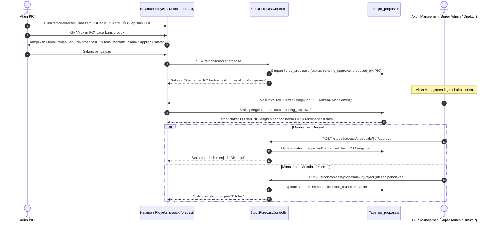

# Desain Teknis: Analisis & Proyeksi Rencana Purchase Order (PO Planning)

**Tanggal:** 21 November 2026  
**Status:** Draf Tinjauan Pengguna  
**Hak Akses Menu:** Khusus Super Admin & PIC  
**Hak Persetujuan Manajemen:** Super Admin & Direktur (Management)  
**Target Modul:** Modul Baru pada Sidebar Navigasi (`/stock-forecast`)

---

## 1. Latar Belakang & Masalah Bisnis

Dalam operasional bisnis alas kaki dan fesyen multikanal (Shopee, TikTok, Grosir), kekurangan stok (*stockout*) berakibat fatal pada hilangnya omzet dan ranking algoritma marketplace, sedangkan kelebihan stok (*overstock*) membekukan arus kas gudang.

Pabrik mitra membutuhkan waktu tunggu produksi (**Lead Time**) rata-rata **3 bulan**. Agar stok di gudang tidak pernah habis atau kosong, sistem membutuhkan kalkulasi otomatis untuk mendeteksi kapan titik pemesanan ulang (**Reorder Point**) tercapai berdasarkan kecepatan penjualan riil (**Sales Velocity**) 3 bulan penuh ke belakang, serta menentukan jumlah pesanan ideal untuk menjaga ketahanan stok hingga **5 bulan ke depan**.

Selain itu, terdapat alur tata kelola antara PIC dan Manajemen:
1. **PIC (Product In Charge):** Memantau analitik stok, kecepatan penjualan, dan mengajukan rekomendasi PO ke Manajemen.
2. **Akun Manajemen (`Super Admin` & `Direktur`):** Menerima pengajuan PO dari PIC, meninjau kuantitas pesanan, dan menyetujui (*Approve*) atau menolak (*Reject*) PO sebelum dikirim ke pabrik mitra.

---

## 2. Parameter & Rumus Perhitungan Matematis (Sesuai Konfirmasi Pengguna)

Sistem bekerja secara objektif berdasarkan data transaksi penjualan riil (bukan tebakan/estimasi acak):

### A. Periode Riwayat (Lookback Period)
- **3 Bulan Penuh ke Belakang** ($M-3, M-2, M-1$).
- Contoh: Jika diakses pada bulan November 2026, sistem menganalisis data riil bulan Agustus, September, dan Oktober 2026.
$$\text{Sales Velocity} = \frac{\text{Penjualan } M_{-3} + \text{Penjualan } M_{-2} + \text{Penjualan } M_{-1}}{3} \quad (\text{pcs / bulan})$$

### B. Parameter Operasional Standar (Bisa Diubah Dinamis di Layar)
- **Target Ketahanan Stok (Target Horizon):** `5 bulan`
- **Lead Time Produksi Pabrik:** `3 bulan`

### C. Indikator & Rumus Kunci

1. **Stok Fisik Gudang Saat Ini ($S_{\text{current}}$):**
   Total kuantitas fisik produk/SKU di gudang yang bersumber dari data `master_stocks` (Warehouse G dan Warehouse A).

2. **Ketahanan Stok Saat Ini ($T_{\text{stok}}$):**
   $$T_{\text{stok}} = \begin{cases} \frac{S_{\text{current}}}{\text{Sales Velocity}}, & \text{jika } \text{Sales Velocity} > 0 \\ \infty \text{ (Stok Tidak Bergerak)}, & \text{jika } \text{Sales Velocity} = 0 \end{cases}$$

3. **Titik Reorder Point ($S_{\text{ROP}}$):**
   Ambang batas sisa stok gudang di mana PO ke pabrik **wajib** segera dikirim:
   $$S_{\text{ROP}} = \text{Lead Time (3 bulan)} \times \text{Sales Velocity}$$

4. **Sisa Waktu Sebelum Wajib PO ($T_{\text{to\_PO}}$):**
   Berapa lama lagi stok gudang akan menyentuh batas kritis reorder point:
   $$T_{\text{to\_PO}} = \frac{S_{\text{current}} - S_{\text{ROP}}}{\text{Sales Velocity}} \quad (\text{bulan})$$

5. **Jumlah Rekomendasi Pesanan PO ($Q_{\text{recom}}$):**
   Jumlah unit yang harus dipesan ke pabrik agar mencapai target ketahanan stok 5 bulan ke depan:
   $$\text{Target Stok} = \text{Target Horizon (5 bulan)} \times \text{Sales Velocity}$$
   $$Q_{\text{recom}} = \max\left(0, \text{Target Stok} - S_{\text{current}}\right)$$

### D. Klasifikasi Status Urgensi

| Status | Kondisi Stok | Sisa Waktu PO | Aksi Sistem |
| :--- | :--- | :--- | :--- |
| 🔴 **Harus PO Sekarang** | $S_{\text{current}} \le S_{\text{ROP}}$ ($T_{\text{stok}} \le 3.0\text{ bln}$) | $\le 0\text{ bulan}$ | Badge merah kontras, prioritas darurat pengajuan PO |
| 🟡 **Siap-siap PO** | $S_{\text{ROP}} < S_{\text{current}} \le \text{Target Stok}$ ($3.0 < T_{\text{stok}} \le 5.0\text{ bln}$) | $0 < T_{\text{to\_PO}} \le 2.0\text{ bln}$ | Badge kuning/amber, estimasi waktu sisa sebelum PO wajib |
| 🟢 **Stok Aman** | $S_{\text{current}} > \text{Target Stok}$ ($T_{\text{stok}} > 5.0\text{ bln}$) | $> 2.0\text{ bulan}$ | Badge hijau emerald, stok mencukupi target 5 bulan |

---

## 3. Simulasi Kasus Nyata (Verifikasi Sesuai Contoh User)

- **Produk:** Sepatu Model A
- **Riwayat Penjualan 3 Bulan:**
  - Bulan 1: 90 pcs
  - Bulan 2: 110 pcs
  - Bulan 3: 100 pcs
  - Total: 300 pcs $\rightarrow$ **Kecepatan Penjualan:** $300 / 3 = 100\text{ pcs/bulan}$
- **Stok Gudang Sekarang:** 400 pcs
- **Hasil Analisis Sistem:**
  - Ketahanan Stok: $400 / 100 = 4.0\text{ bulan}$
  - Reorder Point (Batas Kritis): $3 \times 100 = 300\text{ pcs}$
  - Kapan Wajib PO: $\frac{400 - 300}{100} = 1.0\text{ bulan lagi}$
  - Target Stok 5 Bulan: $5 \times 100 = 500\text{ pcs}$
  - Rekomendasi Pesanan PO: $500 - 400 = 100\text{ pcs}$
  - Status: 🟡 **Siap-siap PO** (1 bulan lagi wajib PO sebesar 100 pcs)

---

## 4. Alur Integrasi: PIC Mengajukan PO $\rightarrow$ Muncul di Akun Manajemen

### Detail Database Pengajuan PO (`po_proposals`):
- `id` (bigint unsigned, primary key)
- `po_number` (string, unik, format: `PO-PRO-YYYYMMDD-XXXX`)
- `sku` (string)
- `product_name` (string)
- `supplier_name` (string, opsional/bisa diisi pabrik tujuan)
- `warehouse` (string, default: 'G')
- `current_stock` (int)
- `monthly_velocity` (decimal: 8,2)
- `stock_coverage_months` (decimal: 8,2)
- `recommended_qty` (int)
- `proposed_qty` (int, default sesuai rekomendasi tapi bisa disesuaikan PIC)
- `status` (`pending_approval`, `approved`, `rejected`, `ordered`)
- `proposed_by` (foreignId -> users.id)
- `reviewed_by` (foreignId -> users.id, nullable)
- `reviewed_at` (timestamp, nullable)
- `notes` (text, nullable)
- `rejection_reason` (text, nullable)
- `created_at`, `updated_at`, `deleted_at`

---

## 5. Arsitektur & Antarmuka Komponen

### A. Hak Akses & Pembagian Role
1. **Super Admin & PIC:**
   - Dapat membuka halaman `/stock-forecast`.
   - Melihat tabel proyeksi ketahanan stok dan rekomendasi PO.
   - Mengajukan PO melalui modal "Ajukan PO".
2. **Super Admin & Direktur (Manajemen):**
   - Melihat tab antrean pengajuan PO dari PIC.
   - Tombol aksi: **Setujui PO** dan **Tolak PO**.
3. **Role Lain (Admin, Gudang, PIC Gudang):**
   - Ditolak (HTTP 403) jika mencoba mengakses URL `/stock-forecast`.
   - Menu tidak ditampilkan di sidebar.

### B. Desain Antarmuka (Anti AI-Slop & Dark Slate Base)
- **Latar Belakang:** `bg-slate-950`
- **Card Panel:** `bg-slate-900/60 border border-slate-800 rounded-2xl p-5`
- **Aksen Warna:** `blue-600` (primary/navy), `emerald-500` (aman), `amber-400` (siap-siap), `rose-500` (harus PO sekarang).
- **Icons:** Heroicons SVG 24x24 clean (tanpa emoji di UI utama).
- **Tab Navigasi Halaman:**
  - **Tab 1: Analisis & Proyeksi Stok** (Tabel analitik data 3 bulan & rekomendasi PO).
  - **Tab 2: Pengajuan PO PIC & Persetujuan Manajemen** (Daftar PO yang diajukan PIC beserta status approval real-time).
- **5 Kartu Statistik Atas:**
  1. Total SKU Dianalisis
  2. 🔴 Harus PO Segera ($\le 3$ bulan)
  3. 🟡 Siap-siap PO ($3 - 5$ bulan)
  4. 🟢 Stok Aman ($> 5$ bulan)
  5. Total Rekomendasi Unit PO

### C. Fitur Tambahan
- **Pengaturan Parameter Dinamis:** Input numerik untuk Target Ketahanan (bulan) dan Lead Time Produksi (bulan).
- **Ekspor Excel:** Tombol instan unduh Excel (.xlsx) data proyeksi stok menggunakan SheetJS.

---

## 6. Rencana Verifikasi & Uji

1. **Uji Formula:**
   - Eksekusi script tes dengan kasus nyata Sepatu A (Stok 400, Penjualan 100/bln $\rightarrow$ Tahan 4 bln, 1 bln lagi PO, Rekomendasi 100 pcs).
2. **Uji Akses:**
   - PIC & Super Admin: Berhasil masuk (HTTP 200).
   - Role lain: HTTP 403 Forbidden.
3. **Uji Alur Pengajuan PIC ke Manajemen:**
   - PIC membuat pengajuan PO.
   - Verifikasi data masuk ke `po_proposals` berstatus `pending_approval`.
   - Akun Manajemen (Super Admin / Direktur) dapat melihat pengajuan tersebut dan melakukan aksi Approve / Reject.
4. **Uji Type & Build:**
   - `npx tsc --noEmit` lulus tanpa error.
